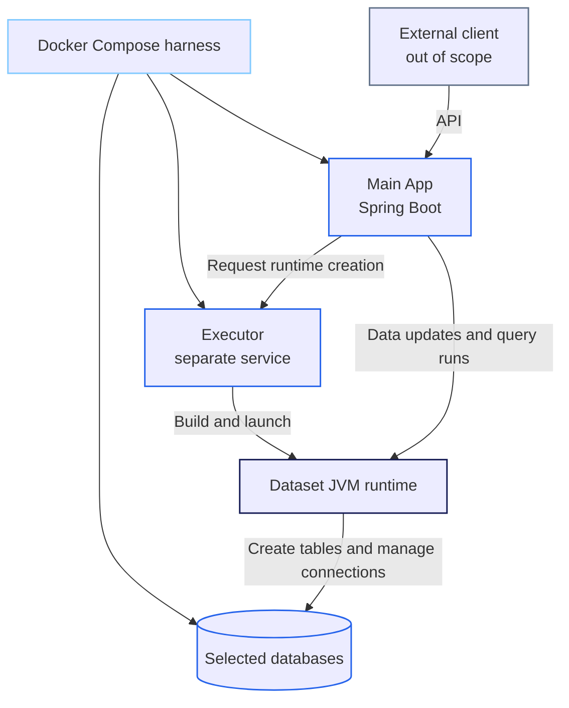

# Application Components

The intended application has two in-scope components: the **Main App** and the **Executor**. Docker Compose is the runtime harness for the Main App, Executor, and selected database services. The client that operates the Main App through its API is external and out of scope. Databases are runtime dependencies, not application components.

## Main App (Spring Boot)

The Main App is the API-facing application. The external client calls its API; client implementation and behavior are outside this project's scope. The Main App owns API handling and dataset metadata. In the intended workflow, it sends the Java source files for a dataset to the Executor together as one bundle, then makes a separate request to build and start the runtime from those uploaded sources. That second request does not carry the schema or source bundle in its body. The Main App can obtain runtime status from the Executor and uses a started runtime for data updates and query runs against the selected databases.

See [MAIN_APP.md](MAIN_APP.md) for the planned internal Spring workflow and its relationship to OpenAPI operations.

## Executor

**Intended design:** The Executor receives the dataset's Java source files together as one bundle. A separate request tells it to compile those uploaded sources and build and start the dataset-specific JVM runtime; that request carries neither a schema nor the source bundle in its body. The Executor supervises the runtime and makes its status available to the Main App. The required source files and bundle format are open design decisions.

**Current implementation:** The Main App sends a schema to the Executor in a create request. The Executor generates Java entity classes from that schema, compiles them, and starts a supervised JVM process. This is not the intended upload-then-build workflow described above.

The runtime is intended to connect to the selected databases, create the tables represented by its entities, and manage the connections used for updates and query runs; those database responsibilities are not implemented yet.

## Docker Compose Harness

Compose starts the Main App, Executor, and selected database services together. The client remains outside the Compose application boundary and calls the Main App API.

## Scope Boundaries

- The **Main App** owns the public API and application-level dataset metadata.
- The **Main App** orchestrates runtime creation and uses the resulting runtime for dataset updates and query runs.
- The **Executor** is intended to compile uploaded Java sources, build and supervise the dataset-specific JVM, and expose its status to the Main App. Its current implementation instead generates entity sources from a schema; database connectivity and table lifecycle responsibilities are not implemented yet.
- The **client** is an external API consumer, not an application component in this architecture.
- The **selected databases** are external dependencies, not additional application components. They are started by Docker as containers or connection to them is added by user in `oxm_config.yaml` before the whole app starts.