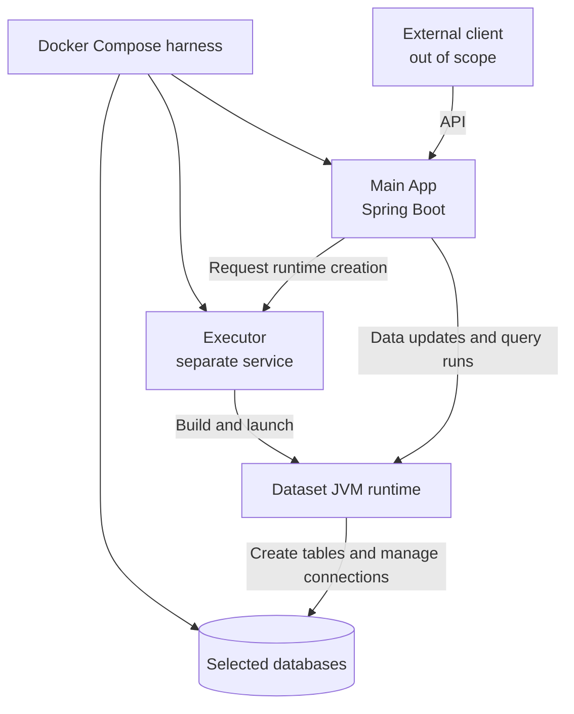

# Application Components

The intended application has two in-scope components: the **Main App** and the **Executor**. Docker Compose is the runtime harness for the Main App, Executor, and selected database services. The client that operates the Main App through its API is external and out of scope. Databases are runtime dependencies, not application components.

## Main App (Spring Boot)

The Main App is the API-facing application. The external client calls its API; client implementation and behavior are outside this project's scope. The Main App owns API handling and dataset metadata. It orchestrates dataset runtime creation by asking the Executor to build and start a JVM for the dataset, then uses that runtime to apply data updates and run queries against the selected databases.

See [MAIN_APP.md](MAIN_APP.md) for the planned internal Spring workflow and its relationship to OpenAPI operations.

## Executor

The Executor is a separate service called by the Main App. It prepares and launches the dataset-specific JVM runtime from a schema or entity Java classes. The runtime is intended to connect to the selected databases, create the tables represented by its entities, and manage the connections used for updates and query runs. The Main App invokes runtime operations; the Executor builds and supervises the runtime.

## Docker Compose Harness

Compose starts the Main App, Executor, and selected database services together. The client remains outside the Compose application boundary and calls the Main App API.

## Scope Boundaries

- The **Main App** owns the public API and application-level dataset metadata.
- The **Main App** orchestrates runtime creation and uses the resulting runtime for dataset updates and query runs.
- The **Executor** builds and supervises the dataset-specific JVM; its database connectivity and table lifecycle responsibilities are not implemented yet.
- The **client** is an external API consumer, not an application component in this architecture.
- The **selected databases** are external dependencies, not additional application components. They are started by Docker as containers or connection to them is added by user in `oxm_config.yaml` before the whole app starts.