# DatasetGenerator workflow

Vocabulary:
- DataBatch: A batch of data generated for a table.
- Item: either a table or a relationship between tables.
- ItemBatch: A batch of items forming one step in ordered graph of generation process.

## Architecture

- Tables are generated in batches based on order decided using directional graph.

- Methods are called repeatedly to create the dataset:
  - table data are generated in batches to avoid running out of memory
  - batches of data forms whole generated files (tables) 
  - files create item batches (generations) 
  - generations creates the whole dataset.

```mermaid
flowchart TD
    subgraph GENERATOR["DatasetGenerator"]
        GENERATE([".generate(dataset, format)"])
        GENERATE_ITEM_BATCH([".generateItemBatch()"])
        GENERATE_ITEM([".generateNextItem()"])
        GENERATE_BATCH([".generateBatch()"])
    
        GENERATE -->|"Generate one batch"| GENERATE_ITEM_BATCH
        GENERATE_ITEM_BATCH -->|"Generate one item"| GENERATE_ITEM
        GENERATE_ITEM -->|"Generate data batch"| GENERATE_BATCH
    end
    
    subgraph DATA_EXPORTER["DataExporter - Implementations"]
        WRITE([".write(filename, data)"])
    end
    
    subgraph ORDERER["DataGeneratorOrderer"]
        ORDER([".decideOrder(dataset)"])
        GRAPH["Relationship dependencies"]
        NEXT([".nextItemBatch()"])
        
        ORDER -->|"Creates Graph"| GRAPH
        GRAPH -->|"Uses data"| NEXT
    end

    GENERATE -->|"Issues creation"| ORDER
    GENERATE_ITEM_BATCH -->|"Requests next batch"| NEXT
    GENERATE_BATCH -->|"Sends data for export"| WRITE
    
    WRITE -->|"Writes to a file"| FILE["Generated File"]

    classDef generator fill: #111111, stroke: #2563EB
    classDef exporter fill: #111111, stroke: #25c01f
    classDef orderer fill: #111111, stroke: #d90606, stroke-width: 1.5px

    class GENERATE,GENERATE_ITEM_BATCH,GENERATE_ITEM,GENERATE_BATCH generator
    class WRITE exporter
    class ORDER,GRAPH,NEXT orderer
```

