# Description of order to generate the tables in the database

Description of order in which to generate tables in the schema based on relationships between them. Illustrated on
Northwind dataset schema example.

## Basic ideas:

For dataset generation we'll introduce two strategies to generate the tables in schema. The first strategy is beneficial in its simplicity and performance, but does not support all possible schemas. The second one is more complex and slower, but supports all possible schemas. The idea is to use the first strategy when possible and fallback to the second one when needed.

### Ordering tables by dependencies

1. Tables that share a relationship of type many-to-one (or one-to-many) creates a dependency between the two tables. The table that is on the "many" side needs id / key of an existing row in the table on the "one" side for it's row to be filled with correct values.

2. Tables that depend on nothing should be generated first. Their ids (keys) will be used to generate data in later tables.

3. Tables that share a relationship of type many-to-many creates an additional relationship table. The relationship table needs ids / keys of existing rows in both tables to be filled with correct values. These tables must be created
after the two tables they depend on.

4. Self-referential relationships are possible to create this way only if represented as an additional table. 

### Representing relationships as independent objects

1. Some DB systems needs the relationships to be represented as independent objects. We'll use this representation to generate some parts of the datasets and representation if aligned in unfavorable way in the schema.

2. When relationships are represented this way, the oriented dependency graph does not include directed circles. This allows us to first generate all the tables, then generate all the relationships. 

3. This strategy might be the optimal one for graph databases.

4. Also, can be used to generate self-referential relationships and Cyclic dependencies in all databases.

## Northwind dataset example

```mermaid
classDiagram

    class Employee {
        +String firstName
        +String lastName
    }
    class Product {
        +String productName
        +String category
    }
    class Supplier {
        +String supplierName
        +String city
    }
    class Order {
        +String orderNumber
        +String orderDate
    }
    class Customer {
        +String customerName
        +String city
    }

    class SuppliesTo {
    }
    class IsPartOf {
    }
    class SuppliesProduct {
    }
    class Ordered {
    }
    class ReportsTo {
    }
    class IsResponsibleFor {
    }

    SuppliesTo "n" --|> "1" Supplier
    SuppliesTo "n" --|> "1" Supplier

    Supplier "1" <|-- "1" SuppliesProduct
    Product "1" <|-- "n" SuppliesProduct

    IsPartOf "1" --|> "n" Order
    IsPartOf "1" --|> "n" Product

    Customer "1" <|-- "1" Ordered
    Ordered "n" --|> "1" Order

    ReportsTo "1" --|> "1" Employee
    ReportsTo "n" --|> "1" Employee

    Employee "1" <|-- "1" IsResponsibleFor
    Order "1" <|-- "n" IsResponsibleFor

    style SuppliesTo fill: #000000, stroke: #93C5FD
    style IsPartOf fill: #000000, stroke: #93C5FD
    style SuppliesProduct fill: #000000, stroke: #93C5FD
    style Ordered fill: #000000, stroke: #93C5FD
    style ReportsTo fill: #000000, stroke: #93C5FD
    style IsResponsibleFor fill: #000000, stroke: #93C5FD

    style Employee fill: #111111, stroke: #1cc327
    style Order fill: #111111, stroke: #1cc327
    style Product fill: #111111, stroke: #1cc327
    style Supplier fill: #111111, stroke: #1cc327
    style Customer fill: #111111, stroke: #1cc327
```

### Order to generate the tables in:

1. **Suppliers** / **Employees** / **Customers**
    - Depends on nothing
2. **Products** / **Orders** / **Suppliers relationships** table
    - Products depends on Suppliers
    - Orders depends on Customers and Employees
    - Suppliers relationships table depends on Suppliers
3. **Products-Orders relationships** table
    - Products-Orders relationships depends on Products and Orders
4. **Fallback** on second strategy for Employees self-referential relationship (Reports to).

### Total tables to generate: 7

- Suppliers
- Employees
- Customers
- Products
- Orders
- Suppliers relationships table
- Products-Orders relationships table
