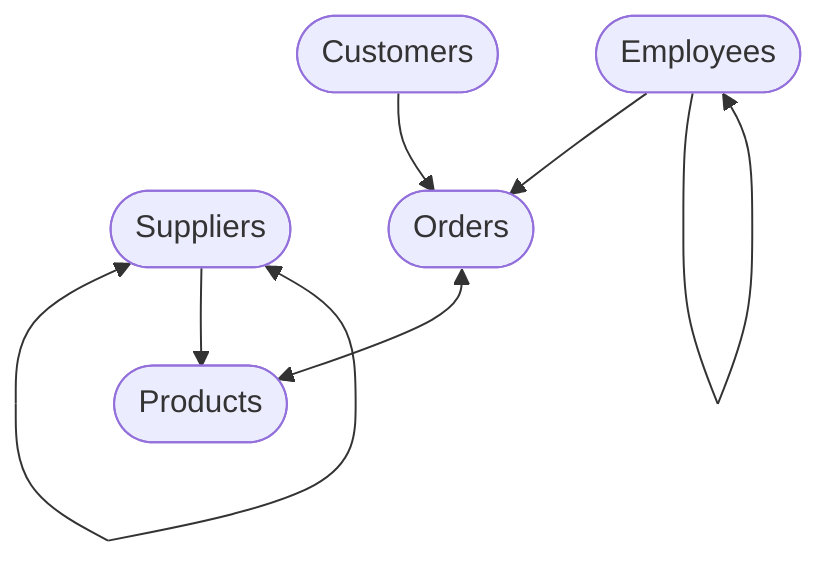

# Description of order to generate the tables in the database

Description of order in which to generate tables in the schema based on relationships between them. Illustrated on
Northwind dataset schema example.

## Basic ideas:

1. Tables that share a relationship of type many-to-one (or one-to-many) creates a dependency between the two tables.
   The table that is on the "many" side needs id / key of an existing row in the table on the "one" side for it's row to
   be filled with correct values.

2. Tables that depend on nothing should be generated first. Their ids (keys) will be used to generate data in later
   tables.

3. Tables that share a relationship of type many-to-many creates an additional relationship table. The relationship
   table needs ids / keys of existing rows in both tables to be filled with correct values. These tables must be created
   after the two tables they depend on.

4. Self-referential relationships can be generated after the table is created. Preferably as an additional table
   regardless of relationship type (**TODO: Final decision pending**).

## Northwind dataset example

### Order to generate the tables in:

1. **Suppliers** / **Employees** / **Customers**
    - Depends on nothing
2. **Products** / **Orders** / **Suppliers relationships** table
    - Products depends on Suppliers
    - Orders depends on Customers and Employees
    - Suppliers relationships table depends on Suppliers
3. **Products-Orders relationships** table
    - Products-Orders relationships depends on Products and Orders

### Total tables to generate: 7

- Suppliers
- Employees
- Customers
- Products
- Orders
- Suppliers relationships table
- Products-Orders relationships table

### Undecided:

- How to generate **self-referential relationships** (if needed / supported) -> e.g. Employees table has a
  self-referential relationship to itself (manager_id). Should it be generated as an additional table or should it be
  generated after the table is created?

- How to generate **cyclic relationships** (if needed / supported) between two or more tables. Not present in Northwind
  dataset.
