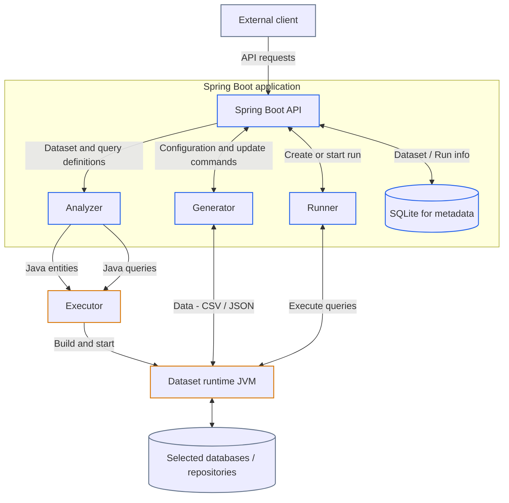

# Main App Internal Workflow

**Status: Planned design.** This document describes the intended internal workflow of the Spring Boot Main App. The
existing OpenAPI contract and source code are evidence of current behavior, not proof that the full workflow is
implemented. The client remains an external system and is outside this document's scope.

## Responsibilities

- The Spring Boot **API layer** implements the OpenAPI contract, accepts client commands, coordinates internal services,
  and returns status or results.
- A small **SQLite metadata store** holds dataset and workflow metadata. It does not hold the benchmark's generated
  records; those belong in the selected database repositories.
- The **Analyzer** validates dataset and query inputs and prepares the Java source files to be sent to the Executor.
- The **Generator** populates or updates repositories through the dataset runtime, using client-provided benchmark
  settings.
- The **Runner** executes the query implementations already included in the runtime and collects execution measurements.
- The separate **Executor** is intended to compile a dataset's uploaded Java source bundle, build and start its
  runtime after a separate start request, and supervise its lifecycle. Runtime status remains available to the Main
  App.

The Main App's Generator is distinct from the existing benchmark pipeline's standalone `generator/` stage.

## Planned Workflow

### 1. Accept and Analyze

The API receives dataset information and the associated OXM/query definitions. The Analyzer runs before runtime
generation. It validates the dataset schema and query descriptions and prepares the Java source files for the Executor.
The Main App sends those files together as one bundle.

The required source files are undecided; whether the bundle includes entity sources, query sources, or other sources
must be established by the design. The bundle format and the entity/query source contracts are also open design
decisions. If the eventual runtime needs common entity or query interfaces, those contracts must be defined before
validation requirements can be specified.

After uploading the source bundle, the Main App makes a separate request telling the Executor to build and start the
runtime from the uploaded sources. This request carries no schema or source bundle in its body. The Executor compiles
the uploaded sources, supervises the runtime, and makes runtime status available to the Main App. The request contract
and how the uploaded bundle is associated with a later build/start request remain to be designed; no route or wire
format is specified here.

### 2. Generate or Update Dataset Records

After runtime creation, the Main App's Generator translates API configuration commands into runtime operations. It uses
the runtime's entity model to add or update records in the selected database repositories. The dataset becomes ready for
benchmarking only after required generation work completes successfully.

### 3. Run Queries and Return Results

The Runner starts a run by asking the runtime to execute the query implementations packaged during analysis/build. It
measures execution time, collects per-query results, and makes the completed results available through the Main App API
when requested.
