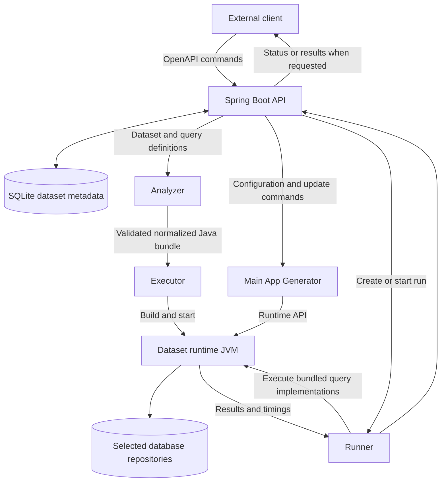

# Main App Internal Workflow

**Status: Planned design.** This document describes the intended internal workflow of the Spring Boot Main App. The existing OpenAPI contract and source code are evidence of current behavior, not proof that the full workflow is implemented. The client remains an external system and is outside this document's scope.

## Responsibilities

- The Spring Boot **API layer** implements the OpenAPI contract, accepts client commands, coordinates internal services, and returns status or results.
- A small **SQLite metadata store** holds dataset and workflow metadata. It does not hold the benchmark's generated records; those belong in the selected database repositories.
- The **Analyzer** validates dataset and query inputs and transforms them into a normalized runtime bundle.
- The **Generator** populates or updates repositories through the dataset runtime, using client-provided benchmark settings.
- The **Runner** executes the query implementations already included in the runtime and collects execution measurements.
- The separate **Executor** builds and starts a dataset runtime from the normalized bundle, then supervises its lifecycle.

The Main App's Generator is distinct from the existing benchmark pipeline's standalone `generator/` stage.

## Planned Workflow

### 1. Accept and Analyze

The API receives dataset information and the associated OXM/query definitions. The Analyzer runs before runtime generation. It validates the dataset schema and query descriptions, checks that the selected OXM has usable entity and query implementations, and converts the inputs into a normalized bundle for the Executor.

The bundle is planned to contain Java entity sources (or an equivalent OXM-specific form) and Java query sources. Entity implementations need a shared contract, such as a required interface or annotation. Query implementations also need a shared interface so the runtime can discover, parameterize, and execute them predictably. The exact contract is an open design decision; generated or supplied classes should be rejected if they do not satisfy it.

The Analyzer sends the Executor the complete validated bundle, including entities and queries. The Executor then builds and starts a runtime containing both, so query classes are present before the run begins.

### 2. Generate or Update Dataset Records

After runtime creation, the Main App's Generator translates API configuration commands into runtime operations. It uses the runtime's entity model to add or update records in the selected database repositories. The dataset becomes ready for benchmarking only after required generation work completes successfully.

### 3. Run Queries and Return Results

The Runner starts a run by asking the runtime to execute the query implementations packaged during analysis/build. It measures execution time, collects per-query results, and makes the completed results available through the Main App API when requested.
