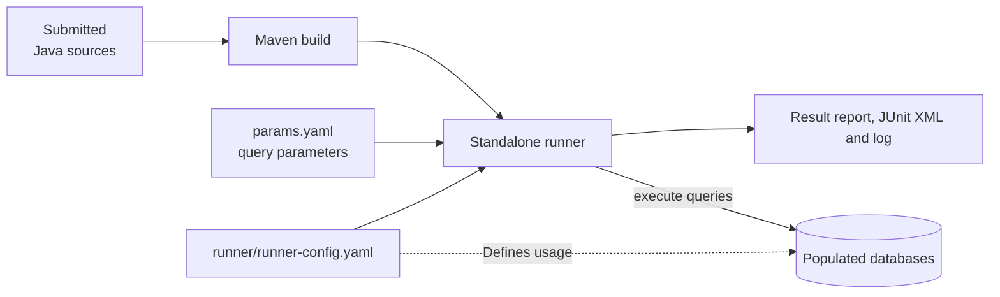
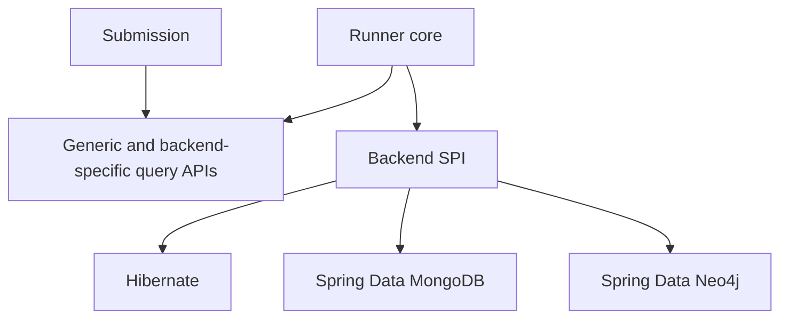
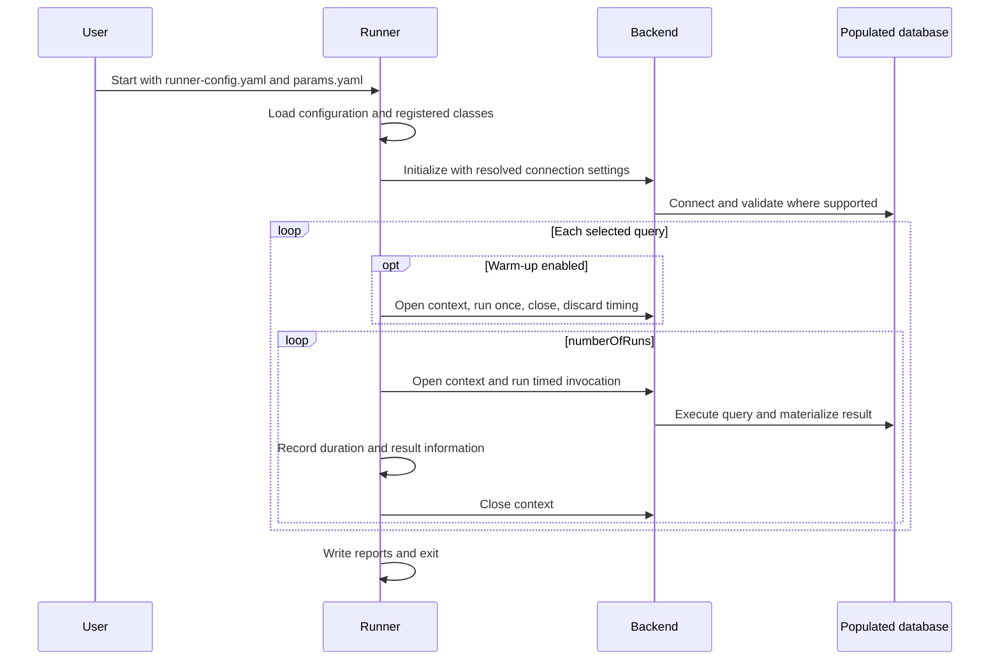

# Runner architecture

The runner is a standalone application in this repository. Java entities and queries are compiled into the runner at build time. The runner measures them against populated databases, writes reports and exits.

## Workflow



The user exports data from the Spring Boot app, imports it into the target databases, then starts the runner. The runner does not import data or alter schemas. Comparable runs require equivalent data, schemas and query semantics across databases.

## Structure



The runner has its own `runner/pom.xml` and Docker image. It is a single Maven project, independent of the Spring Boot build. Its core handles configuration, execution and reporting through the generic `Query` and `Backend` interfaces, so it does not reference ORM types directly. Entities, ORM queries and ORM dependencies live in the backend packages and the submission. Backends are ordinary classes in the runner, one subpackage each, selected from configuration by id; adding a backend is a project update.

Each backend supplies its typed query API, ORM dependencies, context lifecycle, schema validation and metrics. The runner ships as one image and JVM with compatible dependency versions.

## Submission

The submission consists of Java sources compiled into the runner during the Maven build. The first iteration uses a Hibernate example in:

```text
runner/example-submission/src/main/java/
```

`HibernateRegistration` explicitly registers the example's entity and query classes. To use different classes, replace the example sources and update the registration, then rebuild the runner. Submission and runner classes share a classpath and must have distinct fully qualified names.

`RegistrationRegistry` maps backend IDs to query registrations. The test factory selects a registration for each
configured `runner.databases` entry, in configuration order, and creates a separate test for each entry and query.
This allows multiple OXMs (or multiple entries using one OXM) in one sequential run without hardcoding them in the
test factory. Only configured entries are selected.

```java
public interface Query<C, P> {
    String id();
    Class<P> parameterType();
    boolean isOrdered();
    Object run(C context, P params);
}
```

Queries have a no-argument constructor and declare their ID, parameter type and result ordering. The same ID represents the same logical query across backends, with matching ordering. The runner supplies and closes the context. Queries return results for reporting and comparison.

### Parameters

`params.yaml` contains parameter values by query ID. The same values are used across backends:

```yaml
q1:
  employeeId: 42
```

The runner binds each entry to the query's `parameterType()`. Parameterless queries use `NoParams` and have no entry in `params.yaml`. Missing or invalid parameters, duplicate IDs and missing selected queries are errors.
For record parameter types, every field must be present and non-null; unknown fields, duplicate YAML keys, and
incompatible types are rejected. The example submission provides `runner/example-submission/params.yaml`.

## Configuration

The standalone runner uses its own `runner/runner-config.yaml`, separate from the root `oxm_config.yaml` used by the
generator and importer. Its database entries contain independent connection settings, so they must point to databases
populated by the importer. Add only the entries to run; their order determines the execution order.

```yaml
runner:
  numberOfRuns: 20
  warmup: true
  queries: []                     # Empty selects all registered queries.
  paramsFile: ./runner/example-submission/params.yaml
  timeoutMs: 30000
  outputDir: ./runner/out
  databases:
    - id: pg-hibernate
      database: postgres
      backend: hibernate
      connection:
        connection: jdbc:postgresql://localhost:5433/oxm_benchmark
        username: postgres
        password: ${PG_PASSWORD}
```

`databases` is required and must contain at least one entry with a unique ID, database name, backend ID, and
`connection` mapping containing a non-empty `connection` address. Other connection fields are backend-specific;
string values may reference environment variables as `${NAME}`. Undefined variables are errors. Never put credentials
in reports or logs.

All fields shown above are required. An empty `queries` list selects all registered queries.
Relative paths resolve from the runner's working directory, not the configuration file's directory. The provided
example paths assume the repository root as the working directory. The `database` name is independent of the
importer's `databaseToUse`; the loader does not check whether data has been imported.

## Execution



The runner launches registered queries through a JUnit dynamic test factory. Queries run sequentially in deterministic order, with a fresh context for every invocation. Timing starts immediately before the query and includes result materialization; normalization and hashing occur afterward while the context remains open. Warm-up results are discarded. Failed warm-up skips measurements for that query; other work continues when possible. Failures are reported and produce a nonzero exit code.

Fresh contexts reduce context-level cache carry-over but do not clear database, operating-system or JIT caches. Backend timeouts may not stop arbitrary Java code. Schema validation and diagnostic metrics depend on backend capabilities.

## Results

The runner writes `result.json`, `junit.xml` and `run.log`. Reports include the backend and database entry, query ID, repetition, status, duration, result information and errors. Backend-specific metrics remain separate from comparable measurements.

Cross-backend result comparison uses a shared canonical projection format. Unordered results are sorted before hashing, preserving duplicates; ordered results retain their order. Backend-specific entity hashes are not automatically comparable.

## Runtime

Mount the runner configuration and `params.yaml` read-only and provide a writable output directory. Submission classes are already in the image. Database volumes must retain the data imported before the runner starts. External databases need addresses reachable from the runner container; the example's `localhost` address is for running on the host.

Submissions are **trusted code**: containers are not security sandboxes, and read-only ORM settings cannot prevent arbitrary code from writing. Use dedicated databases and least-privilege accounts where possible.
