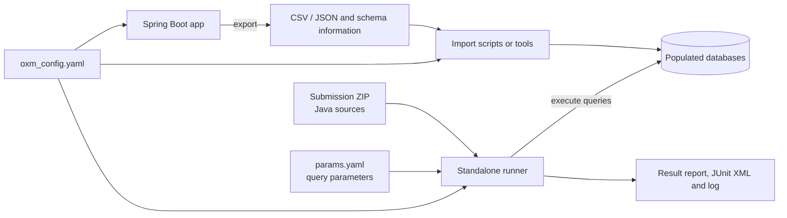
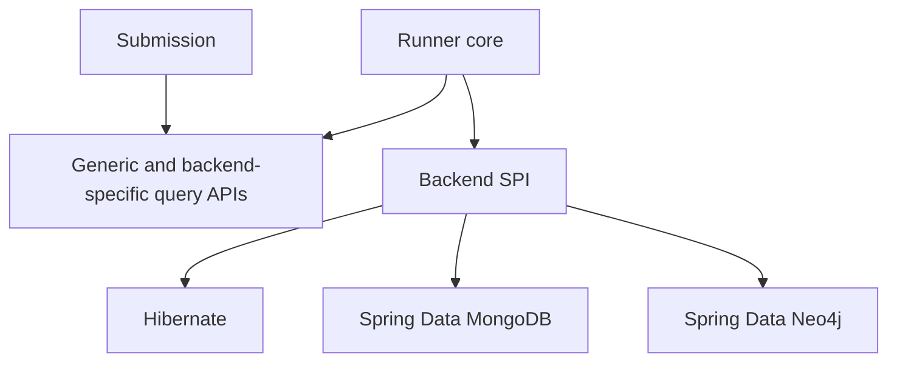
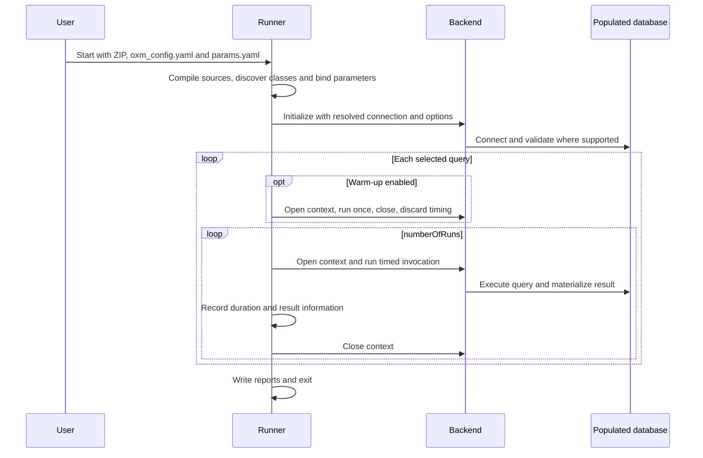

# Runner architecture

The runner is a standalone application in this repository. It compiles trusted Java entities and queries, measures them against populated databases, writes reports and exits.

## Workflow



The user exports data from the Spring Boot app, imports it into the target databases, then starts the runner. The runner does not import data or alter schemas. Comparable runs require equivalent data, schemas and query semantics across databases.

## Structure



The runner has its own `runner/pom.xml` and Docker image. It is a single Maven project, independent of the Spring Boot build. Its core handles configuration, compilation, discovery, execution and reporting without importing ORM types. Backend providers implement the SPI and are discovered with `ServiceLoader`; the executable preserves provider registrations.

Each backend supplies its typed query API, ORM dependencies, context lifecycle, schema validation and metrics. The runner ships as one image and JVM with compatible dependency versions.

## Submission

The submission is a ZIP of Java sources, organized by backend:

```text
shared/
hibernate/
springdata-mongodb/
springdata-neo4j/
```

The runner compiles each selected backend directory with `shared/` against its supported dependencies. It discovers queries by their backend-specific query interface and entities by ORM mapping annotations. Each backend uses a separate submission classloader, allowing backend source sets to use the same class names. No manifest is required.

```java
public interface Query<C, P> {
    String id();
    Class<P> parameterType();
    boolean isOrdered();
    Object run(C context, P params);
}
```

Queries have a no-argument constructor and declare their ID, parameter type and result ordering. The same ID represents the same logical query across backends, with matching ordering. The runner supplies and closes the context. Queries return results for reporting and comparison.

### Parameters

`params.yaml` contains parameter values by query ID. The same values are used across backends:

```yaml
q1:
  employeeId: 42
```

The runner binds each entry to the query's `parameterType()`. Parameterless queries use `NoParams` and have no entry in `params.yaml`. Missing or invalid parameters, duplicate IDs and missing selected queries are errors.

## Configuration

The app, import tooling and runner share `oxm_config.yaml`. Runner settings select databases and backends, repetitions, warm-up, queries, timeout, parameter file and output directory.

```yaml
databaseToUse: [postgres, mongo, mongoEmbedded, neo4j]

generator:
  outputDir: ./generatedData

importer:
  postgres:
    connection: jdbc:postgresql://postgres:5432/oxm_benchmark
    username: postgres
    password: ${PG_PASSWORD}
  mongo:
    connection: mongodb://mongo:27017
    db_name: oxm_benchmark
    db_name_embedded: oxm_benchmark_embedded
  neo4j:
    connection: bolt://neo4j:7687
    username: neo4j
    password: ${NEO_PASSWORD}

runner:
  numberOfRuns: 20
  warmup: true
  queries: []                     # Empty selects all discovered queries.
  paramsFile: ./params.yaml
  timeoutMs: 30000
  outputDir: ./out
  databases:
    - id: pg-hibernate
      database: postgres
      backend: hibernate
      connectionOverrides:
        username: benchmark_reader
        password: ${PG_READER_PASSWORD}
      options: {}
    - id: mongo-springdata
      database: mongo
      backend: springdata-mongodb
      options: {}
    - id: mongo-embedded-springdata
      database: mongoEmbedded
      backend: springdata-mongodb
      options: {}
    - id: neo4j-springdata
      database: neo4j
      backend: springdata-neo4j
      options: {}
```

Each runner database entry references an enabled `databaseToUse` name and a backend matching a submission directory. Connection settings come from `importer`, with optional per-entry overrides. `mongo` and `mongoEmbedded` share a connection but use `db_name` and `db_name_embedded` respectively; the latter denotes an embedded-document layout, not an embedded server. Relative runner paths resolve from its working directory. Credentials can use environment variables and must not appear in reports or logs.

## Execution



Queries run sequentially in deterministic order, with a fresh context for every invocation. Timing starts immediately before the query and includes result materialization; normalization and hashing occur afterward while the context remains open. Warm-up results are discarded. Failed warm-up skips measurements for that query; other work continues when possible. Failures are reported and produce a nonzero exit code.

Fresh contexts reduce context-level cache carry-over but do not clear database, operating-system or JIT caches. Backend timeouts may not stop arbitrary Java code. Schema validation and diagnostic metrics depend on backend capabilities.

## Results

The runner writes `result.json`, `junit.xml` and `run.log`. Reports include the backend and database entry, query ID, repetition, status, duration, result information and errors. Backend-specific metrics remain separate from comparable measurements.

Cross-backend result comparison uses a shared canonical projection format. Unordered results are sorted before hashing, preserving duplicates; ordered results retain their order. Backend-specific entity hashes are not automatically comparable.

## Runtime

Mount the submission, `oxm_config.yaml` and `params.yaml` read-only and provide a writable output directory. Database volumes must retain the data imported before the runner starts. External databases need addresses reachable from the runner container.

Submissions are **trusted code**: classloaders and containers are not security sandboxes, and read-only ORM settings cannot prevent arbitrary code from writing. Use dedicated databases and least-privilege accounts where possible.
