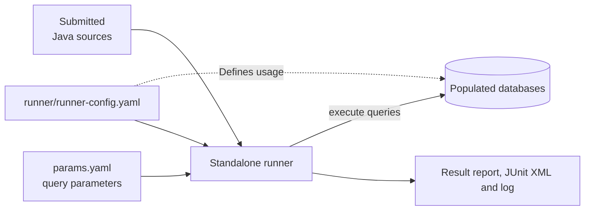
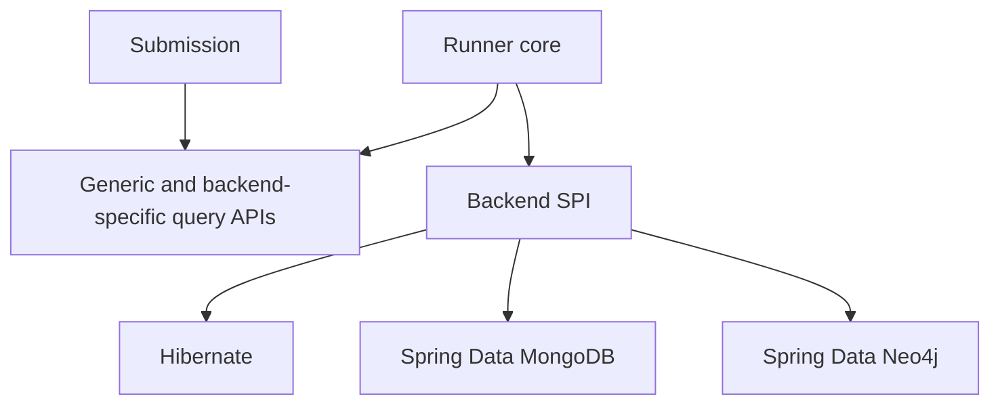
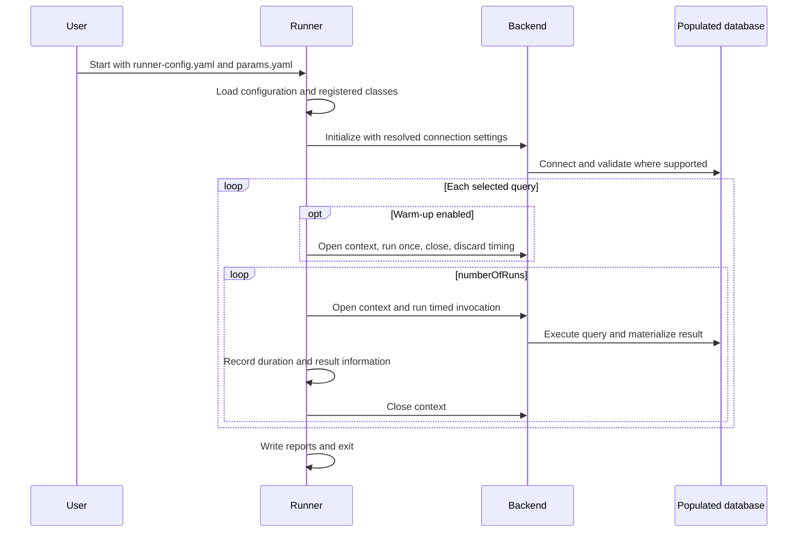

# Runner architecture

The runner is a standalone application in this repository. Hibernate submission sources are compiled at startup; database execution and result reporting are not yet implemented.

## Workflow



The user exports data from the Spring Boot app, imports it into the target databases, then starts the runner. The runner does not import data or alter schemas. Comparable runs require equivalent data, schemas and query semantics across databases.

## Structure



The runner has its own `runner/pom.xml` and Docker image. It is a single Maven project, independent of the Spring Boot build. Its core handles configuration, execution and reporting through the generic `Query` and `Backend` interfaces, so it does not reference ORM types directly. Entities, ORM queries and ORM dependencies live in the backend packages and the submission. Backends are ordinary classes in the runner, one subpackage each, selected from configuration by id; adding a backend is a project update.

Each backend supplies its typed query API, ORM dependencies, context lifecycle, schema validation and metrics. The runner ships as one image and JVM with compatible dependency versions.

## Submission

The submission consists of Java sources compiled by the runner at startup. The default Hibernate example is in:

```text
runner/example-submission/src/main/java/
```

Set `runner.sourceDir` to use another source root. Paths under that root must match the Java packages, all of which
must begin with `queries` (for example `queries/sales/Orders.java` declares `queries.sales.Orders`). Each concrete
query implements `HibernateQuery` and has a public no-argument constructor; classes annotated with
`jakarta.persistence.Entity` are discovered as entities. Helpers and parameter classes belong in the same tree.
The runner compiles all sources together with the application runtime classpath, including Lombok's explicitly
enabled processor, and loads them with a parent-first class loader. Submission class names must not collide with
application classes. A compilation failure rejects the submission with file and line diagnostics; per-class
discovery and constructor failures are reported independently. A JDK is required.

`RegistrationRegistry` maps backend IDs to query registrations. The test factory selects a registration for each
configured `runner.databases` entry, in configuration order, and creates a separate test for each entry and query.
This allows multiple OXMs (or multiple entries using one OXM) in one sequential run without hardcoding them in the
test factory. Only configured entries are selected.

```java
public interface Query<C, P> {
    String id();
    Class<P> parameterType();
    boolean isOrdered();
    Object run(C context, P params);
}
```

Queries have a no-argument constructor and declare their ID, parameter type and result ordering. The same ID represents the same logical query across backends, with matching ordering. The runner supplies and closes the context. Queries return results for reporting and comparison.

### Parameters

`params.yaml` contains parameter values by query ID. The same values are used across backends:

```yaml
q1:
  employeeId: 42
```

The runner binds each entry to the query's `parameterType()`. Parameterless queries use `NoParams` and have no entry in `params.yaml`. Missing or invalid parameters, duplicate IDs and missing selected queries are errors.
For record parameter types, every field must be present and non-null; unknown fields, duplicate YAML keys, and
incompatible types are rejected. The example submission provides `runner/example-submission/params.yaml`.

## Configuration

The standalone runner uses its own `runner/runner-config.yaml`, separate from the root `oxm_config.yaml` used by the
generator and importer. Its database entries contain independent connection settings, so they must point to databases
populated by the importer. Add only the entries to run; their order determines the execution order.

```yaml
runner:
  numberOfRuns: 20
  warmup: true
  queries: []                     # Empty selects all registered queries.
  paramsFile: ./runner/example-submission/params.yaml
  sourceDir: ./runner/example-submission/src/main/java
  timeoutMs: 30000
  outputDir: ./runner/out
  databases:
    - id: pg-hibernate
      database: postgres
      backend: hibernate
      connection:
        connection: jdbc:postgresql://localhost:5433/oxm_benchmark
        username: postgres
        password: ${PG_PASSWORD}
```

`databases` is required and must contain at least one entry with a unique ID, database name, backend ID, and
`connection` mapping containing a non-empty `connection` address. Other connection fields are backend-specific;
string values may reference environment variables as `${NAME}`. Undefined variables are errors. Never put credentials
in reports or logs.

All fields shown above except `sourceDir` are required; its default is
`runner/example-submission/src/main/java`. An empty `queries` list selects all registered queries.
Relative paths resolve from the runner's working directory, not the configuration file's directory. The provided
example paths assume the repository root as the working directory. The `database` name is independent of the
importer's `databaseToUse`; the loader does not check whether data has been imported.

## Execution



The runner currently creates a JUnit dynamic test for each discovered query and each configured database entry,
plus tests for discovery failures. Query instances are distinct per database entry and failures are reported without
preventing other cases from running. **Actual Hibernate execution is not implemented**, so the example cases
currently fail with an explicit unsupported-operation error. The sequence above describes the intended execution.
When implemented, queries are intended to run sequentially with a fresh context per invocation, discarded warm-ups,
and timing that includes result materialization.

Fresh contexts reduce context-level cache carry-over but do not clear database, operating-system or JIT caches. Backend timeouts may not stop arbitrary Java code. Schema validation and diagnostic metrics depend on backend capabilities.

## Results

The runner writes `result.json`, `junit.xml` and `run.log`. Reports include the backend and database entry, query ID, repetition, status, duration, result information and errors. Backend-specific metrics remain separate from comparable measurements.

Cross-backend result comparison uses a shared canonical projection format. Unordered results are sorted before hashing, preserving duplicates; ordered results retain their order. Backend-specific entity hashes are not automatically comparable.

## Runtime

Mount the runner configuration, `params.yaml`, and the configured submission source directory read-only and provide a
writable output directory and temporary directory. The image uses a JDK to compile submission classes at startup.
Database volumes must retain the data imported before the runner starts. External databases need addresses reachable
from the runner container; the example's `localhost` address is for running on the host.

Submissions are **trusted code**: containers are not security sandboxes, and read-only ORM settings cannot prevent arbitrary code from writing. Use dedicated databases and least-privilege accounts where possible.
